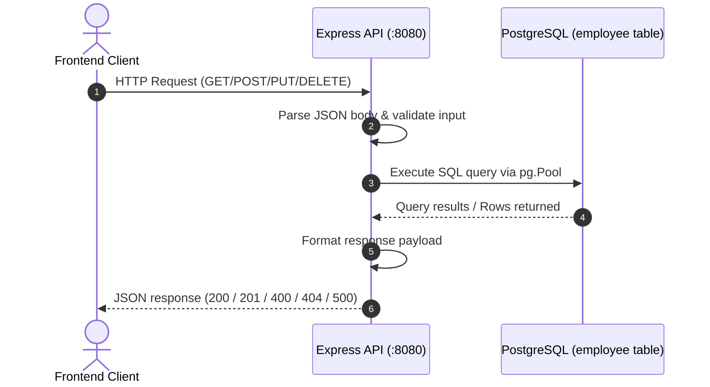

# Architecture & Implementation Status

## 1. Component Layers

### 1.1 Server Layer (`server.js`)
- Initializes Express application.
- Applies `cors()` for cross-origin communication with the frontend.
- Applies `express.json()` for parsing incoming JSON payloads.
- Mounts routes from `app/routes/employee.routes.js`.
- Starts the HTTP listener on port `8080`.

### 1.2 Routing Layer (`app/routes/employee.routes.js`)
- Modular Express router mounted under `/api`.
- Routes:
  - `GET /api/employee` -> `employee.getEmployees`
  - `GET /api/employee/:id` -> `employee.getEmployeeById`
  - `POST /api/employee` -> `employee.createEmployee`
  - `PUT /api/employee/:id` -> `employee.updateEmployee`
  - `DELETE /api/employee/:id` -> `employee.deleteEmployee`

### 1.3 Business Logic & Controller Layer (`app/controllers/employee.controller.js`)
- Handles input validation (required fields, regex email validation).
- Prevents duplicate emails across create and update operations.
- Generates parameterized SQL queries using `$1, $2, ...` to prevent SQL injection.
- Normalizes data output via `formatEmployee()` to provide consistent property access.

### 1.4 Data Access Layer (`app/config/db.config.js`)
- Creates and exports a PostgreSQL connection pool (`Pool` from `pg`).
- Reads credentials (`DB_HOST`, `DB_PORT`, `DB_NAME`, `DB_USER`, `DB_PASSWORD`) from `.env`.

---

## 2. Database Schema

The API communicates with the **`employee`** table in PostgreSQL:

```sql
CREATE TABLE employee (
  employee_id SERIAL PRIMARY KEY,
  full_name VARCHAR(255) NOT NULL,
  email VARCHAR(255) NOT NULL UNIQUE,
  department VARCHAR(100),
  designation VARCHAR(100),
  status VARCHAR(20) NOT NULL DEFAULT 'Active'
);
```

### Columns

| Column | Type | Constraints | Description |
| :--- | :--- | :--- | :--- |
| `employee_id` | `INTEGER` | Primary Key, `SERIAL` | Auto-incrementing identifier |
| `full_name` | `VARCHAR(255)` | `NOT NULL` | Employee full name |
| `email` | `VARCHAR(255)` | `NOT NULL`, `UNIQUE` | Unique email address |
| `department` | `VARCHAR(100)` | Nullable | Assigned department |
| `designation` | `VARCHAR(100)` | Nullable | Job title / role |
| `status` | `VARCHAR(20)` | `NOT NULL`, Default `'Active'` | `'Active'` or `'Inactive'` |

---

## 3. Data Flow



---

## 4. Feature Status & Incomplete Items

### 4.1 Completed Features
- **GET /api/employee**: Retrieves all employees; supports `search` and `status` query parameters.
- **GET /api/employee/:id**: Retrieves a specific employee by ID; returns 404 if not found.
- **POST /api/employee**: Creates a new employee; auto-generates ID via `SERIAL`; enforces email uniqueness.
- **PUT /api/employee/:id**: Updates employee details; validates email conflicts against existing records.
- **DELETE /api/employee/:id**: Removes employee by ID.
- **CORS enabled**: Supports local development across ports.

### 4.2 Incomplete Features & Roadmap
1. **Authentication & Authorization**: Endpoints are currently public. Role-based access control (e.g. JWT or API keys) can be added.
2. **Server-Side Pagination**: The API returns all matching records directly. Pagination (`limit` and `offset`) can be re-introduced if dataset grows large.
3. **Database Migration Tooling**: Schema is managed via raw SQL. A migration tool (Knex, Prisma, or node-pg-migrate) can be adopted for version-controlled migrations.
4. **Automated Testing**: Automated unit and integration tests (Jest/Supertest) are not yet configured in `package.json`.
5. **Audit Logging**: Timestamps (`created_at`, `updated_at`) and audit logging can be introduced to track modifications over time.
