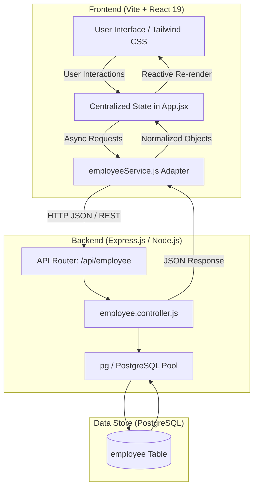

# Architecture & System Design Document

**Project:** Employee Management System  
**Status:** Core CRUD Production-Ready  
**Tech Stack:** React 19, Tailwind CSS v4, Express.js REST API, PostgreSQL  

---

## 1. System Architecture Overview

The system follows a decoupled client-server architecture consisting of a Single Page Application (SPA) frontend, an Express.js RESTful API, and a PostgreSQL relational database.



---

## 2. Frontend Architecture

### 2.1 Component Hierarchy & Layering

The frontend uses a clean presentation-versus-container separation with zero external state libraries:

```
src/
├── main.jsx                     # Application bootstrap & React 19 root
├── App.jsx                      # Container Component (Single source of truth)
├── index.css                    # Global Tailwind v4 directives & font imports
├── services/
│   └── employeeService.js       # Network abstraction & data normalization layer
└── components/
    ├── layout/
    │   └── Navbar.jsx           # Header bar & primary CTA trigger
    ├── employees/
    │   ├── EmployeeTable.jsx    # Tabular presentation of employee records
    │   ├── EmployeeFilters.jsx  # Search bar & status filter pill selector
    │   ├── EmployeeFormModal.jsx# Form modal with validation for Add & Edit
    │   ├── EmptyState.jsx       # Context-aware empty state (search vs no data)
    │   └── ErrorState.jsx       # Network/API failure display with retry action
    └── common/
        ├── Button.jsx           # Reusable accessible button with variant styles
        ├── Badge.jsx            # Status badge pill (Active / Inactive)
        ├── Modal.jsx            # Accessible base modal overlay with keyboard escape
        ├── ConfirmDialog.jsx    # Destructive action confirmation dialog
        ├── LoadingSpinner.jsx   # Contextual loading indicator
        └── Toast.jsx            # Autohiding notification banner
```

### 2.2 State Management Strategy

All domain state is centralized inside `App.jsx` to maintain a single source of truth and predictable data flow:

1. **Server Sync State**:
   - `employees`: Array of normalized employee entities.
   - `loading`: Initial fetch status.
   - `error`: Error message string when API fails.

2. **Filter & Search State**:
   - `searchQuery`: Live text filter string.
   - `statusFilter`: Filter category (`ALL`, `Active`, `Inactive`).
   - `isSearching` & `isFilteringStatus`: Micro-state timers providing instant table loader feedback without blocking inputs.

3. **Modal & Action State**:
   - `isFormOpen`: Controls visibility of Add/Edit modal.
   - `editingEmployee`: Stores the full record fetched from `GET /api/employee/:id`.
   - `deletingEmployee`: Identifies the target record for deletion confirmation.
   - `actionLoadingId`: Tracks row-level actions (status toggle or edit fetch) to display localized spinners.

### 2.3 Data Normalization Layer (`employeeService.js`)

Database column conventions (`full_name`, `employee_id`) differ from frontend camelCase/shorthand properties (`name`, `id`). 

The normalization helper transforms raw payloads into consistent frontend objects:
```javascript
const normalizeEmployee = (emp) => ({
  id: emp.id || emp.employee_id || emp.employeeId,
  name: emp.full_name || emp.name || emp.fullName || '',
  full_name: emp.full_name || emp.name || emp.fullName || '',
  email: emp.email || '',
  department: emp.department || '',
  designation: emp.designation || '',
  status: emp.status || 'Active'
});
```

---

## 3. Implemented Features Matrix

| Feature | Status | Description |
|---|---|---|
| **Employee Directory View** | Complete | Renders Full Name, Email, Department, Designation, Status, and Actions. Primary key is kept internally and hidden from UI. |
| **Add Employee** | Complete | Modal form with validation on Name, Email, Department, and Designation. Sends `POST /api/employee`. |
| **Edit Employee** | Complete | Direct API fetch via `GET /api/employee/:id` prior to opening modal. Updates via `PUT /api/employee/:id`. |
| **Delete Employee** | Complete | Confirmation dialog showing employee name, backdrop loading state, and calls `DELETE /api/employee/:id`. |
| **Instant Search** | Complete | Case-insensitive multi-field search (Name, Email) with table loader state. |
| **Status Filter** | Complete | Filter by `All`, `Active`, or `Inactive` with dynamic counts and table loader state. |
| **In-Row Status Toggle** | Complete | Quick toggle between Active/Inactive by clicking status badge, with inline loader indicator. |
| **Loading & Error States** | Complete | Table spinner, retry button on connection failure, backdrop modal spinners, and auto-dismissing toasts. |

---

## 4. Incomplete & Future Scope Features

While all required core CRUD workflows are fully implemented and integrated with the database, the following architectural enhancements represent incomplete or potential future milestones:

### 4.1 Server-Side Pagination
- **Current State:** The client fetches the full employee list via `GET /api/employee` and performs in-memory slicing and counting.
- **Limitation:** In production environments with 5,000+ employees, transferring the entire dataset increases latency and memory usage.
- **Future Scope:** Implement `page` and `limit` query parameters on the backend (`LIMIT $1 OFFSET $2`) and add pagination controls (Next, Previous, Page Size) in `EmployeeTable.jsx`.

### 4.2 Server-Side Search Debouncing
- **Current State:** Filtering is performed instantly on the client side over the fetched employee array.
- **Limitation:** If pagination is introduced, client-side filtering will only filter the current page instead of the entire database.
- **Future Scope:** Connect the debounced search input directly to `GET /api/employee?search=<term>&status=<status>` so PostgreSQL performs `ILIKE` queries across the full table.

### 4.3 Relational Department Management
- **Current State:** Department and Designation are entered as free-text strings.
- **Limitation:** Inconsistent department names (e.g., "Engineering" vs "eng" vs "ENGINEERING").
- **Future Scope:** Create a dedicated `/api/departments` endpoint and relational `departments` table in PostgreSQL with a dropdown selector on the form.

### 4.4 Authentication & Role-Based Access Control (RBAC)
- **Current State:** Any user with access to the web dashboard can add, edit, or delete any employee record.
- **Future Scope:** Implement JWT authentication with role permissions (e.g., `Admin` can edit/delete; `Manager` can view and change status; `Viewer` has read-only access).

### 4.5 Bulk Operations
- **Current State:** Actions (status toggle, delete) can only be executed one employee at a time.
- **Future Scope:** Checkbox multi-select on table rows with batch actions: "Batch Delete", "Set Selected to Inactive", and "Export Selected to CSV/Excel".

### 4.6 Employee Avatar / Photo Upload
- **Current State:** Displays user name in clean typography with no profile image.
- **Future Scope:** Image upload support (`multipart/form-data`) storing images in cloud storage (S3/Cloudinary) or local file storage.

### 4.7 Form Field Advanced Validation
- **Current State:** Basic client validation checks required non-empty fields and standard email format regex.
- **Future Scope:** Real-time backend validation for unique email constraint before form submission (`GET /api/employee/check-email?email=...`).

---

## 5. Technology Stack & Environment

- **Frontend:** React 19.3, Vite 8.3, Tailwind CSS v4.3, Lucide React 1.60
- **Backend API:** Node.js, Express.js (Port `8080`)
- **Database:** PostgreSQL (Port `5432`)
- **API Base URL:** `http://localhost:8080/api/employee`